# Chess Replay Card

Your latest chess game, replayed move by move on your GitHub profile. Works with Lichess (including crazyhouse) and Chess.com, and needs no token.

<picture>
  <source media="(prefers-color-scheme: dark)" srcset="examples/chess-replay-dark.svg">
  
</picture>

*The demo is Morphy's famous 1858 Opera Game. Yours will show your own latest game.*

Every move slides across a pixel-art board with last-move and check highlights, alongside the players. The result is kept back until the last move lands, then stays in view. The board is shown from your side, so if you played black, it flips. Lichess crazyhouse games are replayed too, with each player's pocket shown beside their name: captured pieces fly into it, and dropped pieces slide from it onto the board. Drops are highlighted in blue, and a pocket slot lights up purple when a captured piece arrives in it. Promoted pieces carry a small pawn badge, since they turn back into pawns when captured. A sibling of [Commit Blaster](https://github.com/surya6032/commit-blaster).

## Add it to your profile

1. Open your profile repository (the repo named exactly after your GitHub username).
2. Create `.github/workflows/chess-replay.yml`:

```yaml
name: chess-replay

on:
  schedule:
    - cron: '0 */6 * * *'
  workflow_dispatch:

permissions:
  contents: write

jobs:
  generate:
    runs-on: ubuntu-latest
    steps:
      - uses: alexanderhu77/chess-replay-card@main
        with:
          username: YOUR_CHESS_USERNAME
          platform: lichess   # or chesscom

      - name: Publish SVGs to the chess-output branch
        run: |
          cd dist
          git init -q
          git checkout -q -b chess-output
          git add .
          git -c user.name="github-actions[bot]" \
              -c user.email="41898282+github-actions[bot]@users.noreply.github.com" \
              commit -q -m "Update chess replay"
          git push -q --force \
            "https://x-access-token:${{ secrets.GITHUB_TOKEN }}@github.com/${{ github.repository }}.git" chess-output
```

3. In the **Actions** tab, pick **chess-replay** and click **Run workflow**.
4. Add this to your profile `README.md`, replacing `YOUR_GITHUB_NAME` with your GitHub username:

```html
<picture>
  <source media="(prefers-color-scheme: dark)" srcset="https://raw.githubusercontent.com/YOUR_GITHUB_NAME/YOUR_GITHUB_NAME/chess-output/chess-replay-dark.svg">
  
</picture>
```

The card refreshes every six hours, so a game you play this afternoon shows up tonight.

## Options

| Input        | Default   | What it does                                                   |
| ------------ | --------- | -------------------------------------------------------------- |
| `username`   | (required)| Your Lichess or Chess.com username                             |
| `platform`   | `lichess` | `lichess` or `chesscom`                                        |
| `game_id`    |           | Show a specific Lichess game instead of your latest, such as your best win |
| `variant`    |           | Lichess only: `standard` or `crazyhouse` to show only that kind of game. Empty means whichever is most recent |
| `max_moves`  | `60`      | Long games replay only their last N moves                      |
| `speed`      | `1`       | Animation speed, from `0.25` to `4`                            |
| `output_dir` | `dist`    | Where the light and dark SVGs are written                      |

## Make the card open the game

The action also gives your workflow `game_url`, a link to the featured game. For Lichess games it opens from the same side of the board as the card. To make the card clickable:

1. In your profile `README.md`, wrap the card in a link. The address can be anything to start with; the workflow fills it in.

```html
<a href="https://lichess.org" title="Open this game on Lichess">
<picture>
  ...
</picture>
</a>
```

2. In the workflow, add `- uses: actions/checkout@v7` as the first step, give the card step `id: card`, and add this as the last step:

```yaml
      - name: Point the card's link at the featured game
        env:
          GAME_URL: ${{ steps.card.outputs.game_url }}
        run: |
          if [ -z "$GAME_URL" ]; then exit 0; fi
          sed -i -E "s#<a href=\"[^\"]*\" title=\"Open this game on Lichess\">#<a href=\"${GAME_URL}\" title=\"Open this game on Lichess\">#" README.md
          if git diff --quiet -- README.md; then exit 0; fi
          git -c user.name="github-actions[bot]" \
              -c user.email="41898282+github-actions[bot]@users.noreply.github.com" \
              commit -q -m "Link the chess card to the featured game" -- README.md
          git pull -q --rebase
          git push -q
```

The workflow then commits a one-line change to your README whenever a new game is featured.

## Run it locally

```bash
git clone https://github.com/surya6032/chess-replay-card
cd chess-replay-card

node cli.js --demo --out preview                       # the Opera Game, no network needed
node cli.js --user your-name --out preview             # your latest Lichess game
node cli.js --user your-name --platform chesscom --out preview
```

Requires Node 18 or newer. There is nothing to install.

## How it works

The action downloads your most recent standard game from the public Lichess or Chess.com API (on Lichess, crazyhouse games count too), then replays it with a small built-in chess engine that handles castling, en passant, promotion, check and crazyhouse drops. The engine is verified against standard perft benchmarks in the test suite. Every piece gets its own CSS keyframes inside a single SVG, so the replay runs anywhere an image does, with no JavaScript. Viewers who prefer reduced motion see the final position.

## Contributing

Good first PRs: new piece sets, board themes, an evaluation bar, or support for more chess sites. Run `npm test` before sending a PR.

## License

MIT
